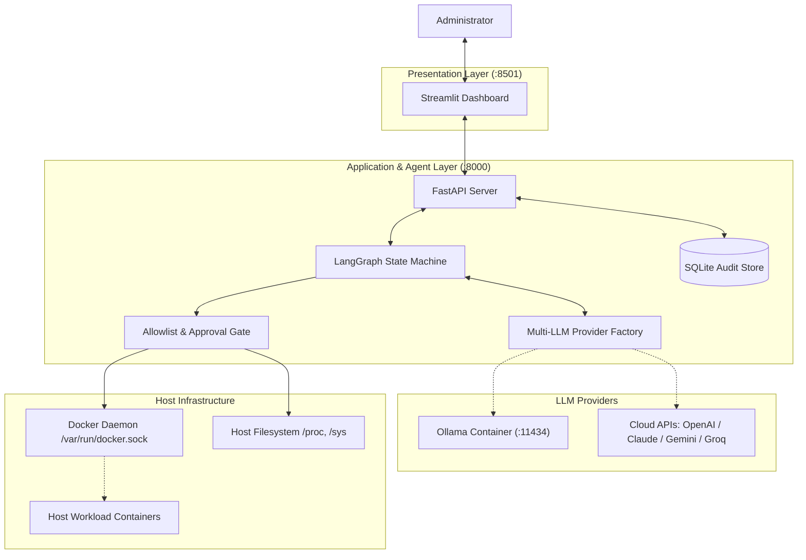

# SysAdmin AI Agent 🤖

> **Autonomous AI-powered System Administration & Container Management Assistant**  
> *Target Platforms:* Ubuntu Server 24.04 LTS, Debian, and cross-platform Linux containers.  
> *Core Stack:* Python 3.12+, LangGraph, Multi-Provider LLMs (OpenAI, Claude, Gemini, Ollama), FastAPI, Streamlit, Docker SDK, psutil.

---

## 🌟 Key Features

1. **Host-Aware Server Observability**: Monitors real-time CPU, RAM, primary disk partition, network throughput, and uptime. Host procfs redirection ensures true host metrics even when running inside Docker.
2. **Container Management & Live Inspection**: Enumerates, monitors, and extracts sanitized stdout/stderr logs from Docker containers.
3. **Pluggable Multi-LLM Reasoning**: Zero-temperature reasoning engine with dynamic support for **OpenAI** (`gpt-4o`, `gpt-4o-mini`), **Anthropic** (`claude-3-5-sonnet`, `haiku`), **Google Gemini** (`gemini-2.5-flash`), **Ollama** (offline local models like `llama3.1`, `qwen2.5`), and **OpenAI-compatible** endpoints (Groq, DeepSeek, vLLM).
4. **Human-in-the-Loop Authorization Gate**: State-changing operations (`restart`, `start`, `stop`) are strictly allowlisted and require an auditable, single-use, cryptographic token approved by a human administrator before execution.
5. **System Self-Protection**: Core SysAdmin infrastructure containers (`sysadmin-backend`, `sysadmin-dashboard`, `sysadmin-ollama`) are permanently protected and cannot be stopped or restarted by the agent.
6. **Post-Action Verification**: Every executed remediation is automatically verified by inspecting the server's real post-execution state.
7. **Turnkey Containerization**: Production Docker Compose stack with optional local LLM (`core` and `local-llm` profiles).
8. **Interactive Dashboard**: Modern multi-tab Streamlit dashboard with real-time metrics, live log viewing, AI event trace, and approval management.

---

## 🏗️ System Architecture



---

## 🚀 Quick Start

### 1. Prerequisites
- Docker Engine & Docker Compose
- Python 3.12+ (if running natively)

### 2. Configure Environment
Copy `.env.example` to `.env` and configure your LLM provider credentials:
```bash
cp .env.example .env
```

For OpenAI (default):
```env
LLM_PROVIDER=openai
LLM_MODEL=gpt-4o-mini
OPENAI_API_KEY=your-api-key-here
```

To use 100% offline local models with Ollama:
```env
LLM_PROVIDER=ollama
LLM_MODEL=llama3.1
LLM_BASE_URL=http://localhost:11434
```

---

### 3. Running Options

#### Option A: Production Docker Compose (Recommended)
Launch the SysAdmin AI Agent stack:
```bash
docker compose up -d
```
- Streamlit Dashboard: `http://localhost:8501`
- FastAPI Documentation: `http://localhost:8000/docs`

To run with a bundled local Ollama container:
```bash
docker compose --profile local-llm up -d
```

#### Option B: Native Python Execution
1. Create and activate a virtual environment:
   ```bash
   python -m venv .venv
   source .venv/bin/activate  # On Windows: .\.venv\Scripts\activate
   pip install -r requirements.txt
   ```
2. Run the interactive terminal agent (Milestone 1):
   ```bash
   python backend/cli.py
   ```
3. Or start the full API and Dashboard:
   ```bash
   # Terminal 1: FastAPI Backend
   uvicorn backend.main:app --host 0.0.0.0 --port 8000

   # Terminal 2: Streamlit Dashboard
   streamlit run dashboard/app.py
   ```

---

## 🧪 Testing

Run the full automated test suite (24 hermetic tests covering tools, security allowlists, approval tokens, LangGraph routing, and live container recovery):
```bash
pytest -v tests/
```

---

## 🔄 Operational Workflow

| Step | Phase | Description |
|---|---|---|
| **1. Perceive** | Host & Container Inspection | The agent queries real-time CPU, memory, disk, network, and container states via psutil and Docker SDK. |
| **2. Reason** | Problem Diagnosis | The LLM evaluates telemetry against configured thresholds, inspects container logs, and identifies stopped or degraded workloads. |
| **3. Propose** | Remediation Planning | Formulates a structured action proposal and generates a single-use cryptographic authorization request. |
| **4. Authorize** | Human Approval Gate | The administrator reviews the incident details and clicks **Approve** (or **Reject** to leave state unchanged). |
| **5. Execute** | Allowlisted Action | The backend verifies token validity and single-use status, then executes the operation against Docker API. |
| **6. Verify** | Post-Action Inspection | The agent immediately re-queries container status, confirming it transitioned to `running`. |
| **7. Audit** | Audit Persistence | All telemetry, decisions, approvals, and outcomes are permanently stored in SQLite. |

---

## 🔒 Security Architecture
- **Self-Protection**: SysAdmin infrastructure containers (`sysadmin-backend`, `sysadmin-dashboard`, `sysadmin-ollama`) cannot be modified by the agent.
- **Configurable Allowlist**: `ALLOWED_CONTAINERS` can be restricted to specific container names or set to `*` to permit managing all host workloads.
- **Zero Arbitrary Execution**: No arbitrary shell command execution is exposed to the LLM.
- **Single-Use Approval Tokens**: Approval tokens expire after 5 minutes and cannot be re-executed (replay protection).
- **Log Sanitization**: Container stdout/stderr logs automatically redact API keys, tokens, and authorization credentials before reaching the LLM.
