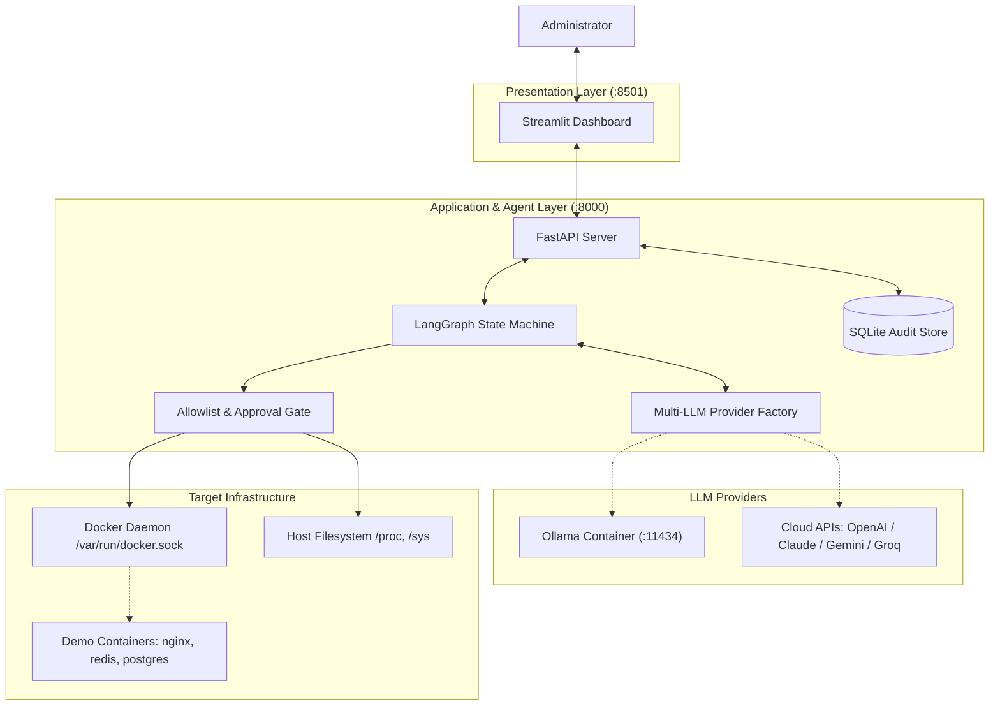

# SysAdmin AI Agent 🤖

> **Autonomous AI-powered System Administration & Container Management Assistant**  
> *Target Platforms:* Ubuntu Server 24.04 LTS, Debian, and cross-platform Linux containers.  
> *Core Stack:* Python 3.12+, LangGraph, Multi-Provider LLMs (OpenAI, Claude, Gemini, Ollama), FastAPI, Streamlit, Docker SDK, psutil.

---

## 🌟 Key Features

1. **Host-Aware Server Observability**: Monitors real-time CPU, RAM, primary disk partition, network throughput, and uptime. Host procfs redirection ensures true host metrics even when running inside Docker.
2. **Container Management & Live Inspection**: Enumerates, monitors, and extracts sanitized stdout/stderr logs from Docker containers.
3. **Pluggable Multi-LLM Reasoning**: Zero-temperature reasoning engine with dynamic support for **OpenAI** (`gpt-4o`, `gpt-4o-mini`), **Anthropic** (`claude-3-5-sonnet`, `haiku`), **Google Gemini** (`gemini-2.5-flash`), **Ollama** (offline local models like `llama3.1`, `qwen2.5`), and **OpenAI-compatible** endpoints (Groq, DeepSeek, vLLM).
4. **Human-in-the-Loop Authorization Gate**: State-changing operations (`restart`, `start`, `stop`) are strictly allowlisted and require an auditable, single-use, cryptographic token approved by a human administrator before execution.
5. **Post-Action Verification**: Every executed remediation is automatically verified by inspecting the server's real post-execution state.
6. **Turnkey Containerization**: Modular Docker Compose stack with profiles (`core`, `local-llm`, and `demo`).
7. **Interactive Dashboard**: Modern multi-tab Streamlit dashboard with real-time metrics, live log viewing, AI event trace, and approval management.

---

## 🏗️ System Architecture



---

## 🚀 Quick Start

### 1. Prerequisites
- Docker Engine & Docker Compose
- Python 3.12+ (if running natively)

### 2. Configure Environment
Copy `.env.example` to `.env` and set your preferred provider:
```bash
cp .env.example .env
```

To use cloud models:
```env
LLM_PROVIDER=openai
LLM_MODEL=gpt-4o-mini
OPENAI_API_KEY=your-api-key-here
```

To use 100% offline local models with Ollama:
```env
LLM_PROVIDER=ollama
LLM_MODEL=llama3.1
LLM_BASE_URL=http://localhost:11434
```

---

### 3. Running Options

#### Option A: Turnkey Docker Compose (Recommended)
Launch the entire stack (Backend + Dashboard + Sandbox Demo Containers):
```bash
docker compose --profile demo up -d
```
- Streamlit Dashboard: `http://localhost:8501`
- FastAPI Documentation: `http://localhost:8000/docs`

To include a local Ollama container:
```bash
docker compose --profile local-llm --profile demo up -d
```

#### Option B: Native Python Execution
1. Create and activate a virtual environment:
   ```bash
   python -m venv .venv
   source .venv/bin/activate  # On Windows: .\.venv\Scripts\activate
   pip install -r requirements.txt
   ```
2. Start the demo sandbox containers:
   ```bash
   docker compose -f docker-compose.demo.yml up -d
   ```
3. Run the interactive terminal agent (Milestone 1):
   ```bash
   python backend/cli.py
   ```
4. Or start the full API and Dashboard:
   ```bash
   # Terminal 1: FastAPI Backend
   uvicorn backend.main:app --host 0.0.0.0 --port 8000

   # Terminal 2: Streamlit Dashboard
   streamlit run dashboard/app.py
   ```

---

## 🧪 Testing

Run the full automated test suite (24 tests covering tools, security allowlists, approval tokens, LangGraph routing, and live container recovery):
```bash
pytest -v tests/
```

---

## 🎭 The 7-Act Live Demonstration Script

| Act | Activity | Description |
|---|---|---|
| **Act 1** | System Introduction | Introduce the agent as an autonomous sysadmin that acts with real tools and human approvals. |
| **Act 2** | Health Check | Ask: *"Perform a complete health check of my server."* The agent queries CPU, memory, disk, and containers. |
| **Act 3** | Introduce Failure | Simulate outage: `docker stop nginx-demo` |
| **Act 4** | Autonomous Diagnosis | Ask: *"Investigate my Docker containers and find any stopped services."* The agent detects `nginx-demo` exited, inspects logs, records an incident, and formulates a remediation proposal. |
| **Act 5** | Human Authorization | The agent requests approval: *"Proposed Action: restart_container on nginx-demo"*. The administrator clicks **Approve** (or test **Reject** to verify safe non-execution). |
| **Act 6** | Recovery & Verification | The agent executes the restart, re-queries container status, confirms it is `running`, and outputs a verified recovery report. |
| **Act 7** | Audit Trail | Review the complete execution timeline and SQLite audit history in the dashboard. |

---

## 🔒 Security Architecture
- **Strict Allowlist**: Only containers explicitly listed in `ALLOWED_CONTAINERS` (default: `nginx-demo`, `redis-demo`, `postgres-demo`) can be restarted, started, or stopped.
- **Zero Arbitrary Execution**: No arbitrary shell command execution is exposed to the LLM.
- **Single-Use Approval Tokens**: Approval tokens expire after 5 minutes and cannot be re-executed (replay protection).
- **Log Sanitization**: Passwords, API keys, and authorization headers are automatically redacted from all log inspections.
